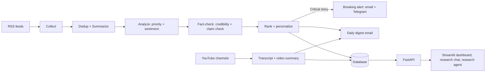

# AI Briefing Agent

> An autonomous multi-agent AI system that reads news and YouTube for you, analyzes everything with Google Gemini, and delivers a prioritized daily briefing, breaking-news alerts (email and Telegram) and a weekly intelligence report. It also ships a REST API, a Streamlit dashboard and a research chat that answers questions from the collected news with source citations (RAG).

**Status:** working end to end, deployed on Render with GitHub Actions scheduling, covered by over 620 automated tests that all run offline, with lint and a coverage gate in CI. Accounts, personal feeds, per-user digests and migrations are in place. Login rate limiting, JSON logs with request IDs and startup security checks are in place. Retention cleanup and SQLite backups are in place. Users can add their own sources. Next: nothing required (public demo deployment and screenshots skipped by choice). The ORACLE dashboard upgrade is in progress (see the ORACLE upgrade section).

## Project summary

Keeping up with news means opening many sites, feeds and videos every day. This project does that work automatically:

1. **Collects** articles from RSS feeds and new videos (with transcripts) from YouTube channels.
2. **Merges** the same story reported by several outlets and **summarizes** it with Gemini.
3. **Analyzes** every story: priority (Critical / High / Medium / Low), sentiment, and how many independent sources confirm it.
4. **Delivers** a ranked daily email, an immediate alert for Critical stories (email and Telegram) and a weekly report with trending topics.
5. **Answers questions** about the collected news (also in Roman Urdu / Hinglish) with citations, and refuses to answer when the news does not contain the answer.

## Features

- **Collection:** RSS feeds (BBC, Dawn, TechCrunch, The Guardian) and YouTube channels (RSS plus transcripts); one failing source never stops the rest
- **Deduplication:** the same story from several outlets is merged by TF-IDF similarity and shared title keywords
- **AI summaries:** 2-3 sentence story summaries; YouTube videos get a summary, key points and a takeaway
- **Analysis:** priority and sentiment for all stories in a single LLM call, with safe defaults if the model answers badly
- **Source credibility:** "Confirmed by N sources" versus "Single source"
- **Claim check:** one LLM call compares how outlets report the same story; stories where key details differ are labelled "Details differ"
- **Breaking alerts:** an immediate email and Telegram message for Critical stories, never sent twice for the same story; a Telegram failure never blocks the pipeline
- **Personalization:** your interests (dashboard sidebar, `PUT /interests`, or the `INTERESTS` setting) move matching stories up one priority tier, never above High or Critical
- **Daily digest and weekly report:** ranked stories, YouTube highlights, trending topics and a week-over-week comparison
- **Research chat (RAG):** semantic search with Gemini embeddings (cached, TF-IDF fallback), answers with citations
- **Research agent:** a topic is split into sub-questions, each is searched in the collected news, and one grounded report is written with citations and a "Not covered" section
- **Accounts:** register and login with signed tokens, salted PBKDF2 password hashes and per-user interests
- **Personal feed:** `GET /me/feed` re-ranks stored stories by the logged-in user's own interests
- **Per-user digest:** opted-in users get their own daily email, ranked by their interests, at most one per day
- **API and dashboard:** FastAPI endpoints and a Streamlit dashboard (Stories, Videos, Stats, Chat, Research, My feed)

## Architecture



The daily pipeline is orchestrated with **LangGraph**: conditional edges skip all work (and all API calls) when nothing is new, and add the alert step only when a Critical story exists. A second, lightweight graph checks for breaking alerts and makes a single LLM call.

## Tech stack

Python 3.11, FastAPI, LangGraph, Google Gemini (summaries, analysis, embeddings), scikit-learn, SQLAlchemy with Alembic migrations (SQLite by default, PostgreSQL supported), APScheduler, Streamlit, feedparser, youtube-transcript-api, pytest, GitHub Actions, Render.

## Quick start

One command setup (no Docker needed): `powershell -ExecutionPolicy Bypass -File scripts/setup.ps1` on Windows, `bash scripts/setup.sh` on Linux/Mac.

```bash
python -m venv venv
venv\Scripts\activate            # Windows (Linux/Mac: source venv/bin/activate)
pip install -r requirements.txt
copy .env.example .env           # Windows (Linux/Mac: cp .env.example .env), then fill in your Gemini key and Gmail App Password
```

```bash
python -m app.scheduler --digest-now --all   # build and email a digest now
uvicorn app.main:app --reload                # API on http://127.0.0.1:8000/docs
streamlit run dashboard/app.py               # dashboard on http://localhost:8501
python -m app.scheduler                      # daily digest, alerts, weekly report
python -m pytest tests -q                    # run the test suite
python -m app.core.migrate                   # create or upgrade the database schema
```

## Configuration

Copy `.env.example` to `.env`. Main settings: `GEMINI_API_KEY`, `EMAIL_SENDER`, `EMAIL_PASSWORD`, `EMAIL_RECEIVER`, `DATABASE_URL`, `API_KEY`, `DASHBOARD_PASSWORD`, `INTERESTS` (comma-separated keywords, optional), `TELEGRAM_BOT_TOKEN` and `TELEGRAM_CHAT_ID` (optional). Accounts need `AUTH_SECRET` (a long random string; leave it empty to switch accounts off) and optionally `AUTH_TOKEN_HOURS` (token lifetime, default 72). Run `python -m scripts.sync_env_example` to add any setting missing from `.env.example`.

### Telegram setup

1. Message `@BotFather` on Telegram, send `/newbot` and copy the token.
2. Send `/start` to your new bot.
3. Open `https://api.telegram.org/bot<TOKEN>/getUpdates` and read `chat.id`.
4. Put both values in `.env` (and in the Render service environment). Never commit them.

## API

`GET /health`, `/stories`, `/articles`, `/stats`, `/videos`, `/weekly`, `/interests`, `PUT /interests`, and `POST /chat`, `/research`, `/run-digest`, `/run-alerts`, `/run-videos`, `/run-weekly`, `/run-cleanup`, `/run-user-digests`, `/research/web`. Interactive docs are served at `/docs`. The core endpoints require the `X-API-Key` header when `API_KEY` is set.

Account endpoints use `Authorization: Bearer <token>`: `POST /auth/register`, `POST /auth/login`, `GET /me`, `PUT /me/interests`, `GET /me/feed`, `GET /me/delivery` and `PUT /me/delivery` (digest on/off, Telegram chat id, digest hour), `GET /me/sources`, `POST /me/sources` and `DELETE /me/sources/{id}`. Bookmarks: `GET /me/bookmarks`, `PUT` and `DELETE /me/bookmarks/{story_id}`. Read status: `GET /me/reads`, `PUT` and `DELETE /me/reads/{story_id}`. API keys: `GET`, `POST` and `DELETE /oracle/keys` (need `API_KEY`). Read-only helpers: `GET /related?q=`, `GET /oracle/analytics`, `/oracle/system`, `/oracle/alerts`, `/oracle/runs`, `/oracle/sources`.

## Demo mode

Set `DEMO_MODE=true` on a separate instance to make it read-only: every request that changes data (digests, accounts, settings, sources) answers 403, while reading, `/chat` and `/research` keep working. Use it for a public demo.

## Live demo

A read-only demo is described in `docs/DEMO_DEPLOY.md`. After deploying it, check it with `python -m scripts.smoke_demo <url>`.

## Deployment

The API and dashboard run on Render (`render.yaml`). GitHub Actions (`scheduled.yml`) wakes the service and calls `/run-digest`, `/run-alerts` and `/run-weekly` on a schedule. Secrets (`API_URL`, `API_KEY`) live in the repository's Actions secrets.

## Production checklist

Set these in the Render service environment (never commit them):

| Variable | Notes |
|----------|-------|
| `GEMINI_API_KEY`, `EMAIL_*` or `RESEND_API_KEY`, `DATABASE_URL` | Required for the pipeline |
| `API_KEY` | Protects the core endpoints; also set it in the GitHub Actions secrets |
| `AUTH_SECRET` | At least 32 random characters, generated separately from your local one |
| `DASHBOARD_PASSWORD` | Protects the dashboard |
| `TRUST_PROXY_HEADERS` | `true` on Render, so rate limits see the real client IP (leave `false` when not behind a proxy) |
| `DEBUG` | `false` |
| `AUTH_RATE_LIMIT`, `AUTH_RATE_WINDOW_SECONDS` | Defaults: 10 attempts per 300 seconds, `0` turns it off. The dashboard calls the API from one IP, so `render.yaml` sets 30 until the dashboard forwards client IPs |
| `RETENTION_DAYS` | Default 90, `0` turns cleanup off |

The server logs one JSON line per request (method, path, status, duration, `request_id`) and answers every request with an `X-Request-ID` header, so a user can quote it when reporting a problem. Startup warns about unsafe settings. The rate limiter lives in memory by default: it resets on restart and is per instance. Set `RATE_LIMIT_PERSISTENT=true` to keep hits in the database (needs PostgreSQL on Render; falls back to memory if the database fails).

## Evaluation

```bash
python -m evals.run_eval              # dedup precision / recall / F1 (offline)
python -m evals.run_eval --priority   # priority accuracy (calls Gemini)
python -m evals.run_eval --claims     # does the claim check catch contradicting outlets (calls Gemini)
```

The labelled set lives in `evals/dataset.json`. Latest results with the real model (step 70): dedup 12 cases, precision and recall 1.0; claims 11 cases, accuracy 1.0; priority 30 cases, accuracy 1.0 (Critical precision and recall 1.0); answers 10 cases, answerable accuracy, retrieval hit rate and refusal rate all 1.0. The step 58 prompt change fixed the three local-news cases that used to be rated Low. The sets are small, so 1.0 means correct on these cases, not always correct. It is small on purpose and meant to grow: add a case whenever the system gets something wrong. Run it before and after changing prompts, ranking or dedup.

## Project structure

```
app/
  main.py, pipeline.py, scheduler.py, video_pipeline.py, weekly.py
  agents/      summarizer, analyzer, factchecker, claim_checker, claim_support, ranker,
               alert_agent, email_agent, research, deep_research,
               video_agent, weekly_email, user_digest
  api/         routes, security, auth, middleware
  collectors/  rss, youtube
  core/        config, database, models, storage, dedup, embeddings,
               search_store, interests, mailer, telegram_notifier, story, video,
               users, tokens, personalize, migrate, ratelimit, ratelimit_store, safe_fetch, logging_setup,
               security_checks, maintenance, user_sources, category, oracle_stats, runs, bookmarks, reads, source_health
  graph/       briefing (daily pipeline), alerts (breaking alerts)
dashboard/     Streamlit app, accounts UI, API client, helpers
dashboard/oracle/  ORACLE dashboard (theme, components, pages, pdf_export); entry point oracle_app.py
scripts/       setup.ps1, setup.sh, sync_env_example.py, dedupe_stories.py
tests/         automated tests (all external services are faked)
evals/         labelled dataset and quality evaluation
migrations/    Alembic migration scripts (0001 baseline, 0002 user sources, 0003 story claims, 0004 user delivery, 0005 image_url, 0006 bookmarks, 0007 pipeline runs, 0008 story reads, 0009 source health, 0010 api keys)
.github/workflows/  tests.yml (CI), scheduled.yml (calls the deployed API)
render.yaml
```

## Development progress

### Completed

| # | Step | What was built |
|---|------|----------------|
| 1-21 | Core system | Environment, structure, config, RSS, database and dedup, Gemini summaries, pipeline, email digest, scheduler, priority and sentiment, source credibility, LangGraph orchestration, breaking alerts, REST API, research chat (RAG) with embeddings, dashboard, YouTube intelligence, weekly report, PostgreSQL support, GitHub |
| 22 | CI | GitHub Actions workflow running the test suite on every push |
| 23 | Telegram notifier | Standalone notifier module with offline tests |
| 24 | Telegram alerts | Critical stories also go to Telegram after the email; failures never block the pipeline |
| 25 | Personalization | Interests setting moves matching stories up one tier, never above High or Critical |
| 25b | Interests API | Interests stored in the database (GET/PUT /interests) |
| 25c | Dashboard form | Sidebar form to edit interests |
| 26 | Claim check | One LLM call flags stories where outlets disagree on key details |
| 27 | Research agent | Multi-step report with citations (POST /research, Research tab) |
| 27b | Cross-outlet dedup | Same story from different outlets merged by title keywords; stricter Critical prompt |
| 28 | Offline RSS tests | RSS collector tests use fake feeds; the whole suite runs without internet |
| 29 | Quality gate in CI | ruff lint and a minimum 80% coverage check run on every push |
| 30 | Accounts core | Users table, salted PBKDF2 password hashing, signed login tokens, `/auth/register`, `/auth/login`, `/me`, `/me/interests` |
| 31 | Personal feed | `GET /me/feed` re-ranks stored stories by the logged-in user's own interests |
| 32 | Dashboard accounts | Login and register in the sidebar, plus a My feed tab with per-user interests |
| 33 | Per-user digest | Opted-in users get a daily email ranked by their own interests, at most one per day; one failing user never blocks the others |
| 34 | Migrations baseline | Alembic baseline (`0001`) and `python -m app.core.migrate`, which also adopts existing databases without touching their data |
| 35 | Rate limiting | Login and register are limited per IP, and login also per email (default 10 attempts per 5 minutes); answers 429 with `Retry-After` |
| 36 | Logging and security checks | JSON logs, `X-Request-ID` on every response, hidden 500 details, security headers and startup warnings for unsafe settings |
| 37 | Retention and backup | `POST /run-cleanup` (weekly in GitHub Actions) deletes articles, digested records and embeddings older than `RETENTION_DAYS` (default 90); `python -m app.core.maintenance backup` makes a safe SQLite backup and keeps the newest 7 |
| 38 | User sources | Users add up to 8 RSS feeds or YouTube channels (`/me/sources`, dashboard form); only public http(s) URLs are accepted, re-checked before every collection; their stories carry a `(custom)` label; migration `0002` |
| 39 | Evaluation set | `evals/` holds a labelled dataset and `python -m evals.run_eval` reports dedup precision/recall/F1 and (with `--priority`) priority accuracy, so prompt and ranking changes can be measured |
| 40 | License and contributing guide | MIT `LICENSE` and `CONTRIBUTING.md` |
| 41 | Dedup tuning | A title+summary overlap rule merges the same story told with different words; on the 8-case evaluation set dedup scores precision 1.0 and recall 1.0 (the set is small, see Evaluation) |
| 42 | Per-claim support | One extra LLM call extracts up to 3 key claims for multi-outlet stories and marks each as confirmed, disputed or single source by outlet; shown in the digest email |
| 43 | Claim check wired into the daily graph | The `claims` step now runs in the briefing graph; before this the claim check only ran in the standalone pipeline |
| 44 | Claims in database, API and dashboard | `stories.claims_json` (migration `0003`); `/stories` and `/me/feed` return `claims`; dashboard cards and per-user digests show them. App startup now runs Alembic migrations once per process |
| 45 | Per-user delivery | Each user sets a Telegram chat id (short top-5 list after the email) and an own digest hour (UTC); users without an hour get theirs with the main digest. `POST /run-user-digests` runs hourly at :05 from GitHub Actions; migration `0004` |
| 46 | Feed scope | `GET /me/feed?scope=mine` hides stories that come only from other users' custom sources (default `all` is unchanged); dashboard checkbox in My feed |
| 47 | Query bounds | `/stories?hours=` is capped at one year (8760), so absurd values answer 422 instead of a server error |
| 48 | Error alerts and audit | Server 500s and failed scheduler jobs send a Telegram and email alert (same error at most once per `ERROR_ALERT_COOLDOWN_MINUTES`, at most 10 per hour; no request data in the alert); CI runs a non-blocking `pip-audit` job |
| 49 | Research follow-up search | A sub-question that finds no matching news gets one rewritten follow-up search (one extra LLM call, one round only); if it still finds nothing it stays under "Not covered". `RESEARCH_FOLLOWUP=false` turns it off |
| 50 | Answer-quality evaluation | `python -m evals.run_eval --answers` runs the research chat on a small fixed news library: does it cite the right source, and does it refuse questions the news cannot answer (refusal is a text heuristic). The priority set grew from 8 to 16 cases |
| 51 | Coverage | Offline tests for the pipeline, summarizer, video pipeline and the scheduler entry points (flags, job wiring, user digests after the main digest) |
| 52 | Docs and setup sync | One-command setup scripts (no Docker), `scripts/sync_env_example.py` keeps `.env.example` in step with the settings and a test guards it, README brought up to date |
| 53 | Demo mode and pinned deploy | `DEMO_MODE=true` makes an instance read-only (writes and logins answer 403, `/chat` and `/research` still work); Render builds from the pinned `requirements.txt`; Telegram keys added to `.env.example` |
| 54 | Web source check | `POST /research/web` checks a claim or topic with Gemini Google Search grounding and returns the answer with real web links; it refuses to answer when no web source is found; limited to 20 requests per hour per IP; still works in demo mode |
| 55 | Web check in dashboard | The Research tab has a "Web par check karein" section (claim in, answer and real web links out); the web check CLI prints one clean error line on quota or key problems |
| 56 | Bigger evaluation sets | 4 more dedup cases (two merge cases, two look-alike traps), 8 more priority cases and 4 more claim cases; the claim eval test now computes its expected numbers from the dataset, so the set can keep growing |
| 57 | Secret scan and README order | `tests/test_secret_scan.py` scans every tracked file for key patterns (Gemini, GitHub, Resend, Telegram, private keys) and checks that no `.env` or `.db` file is tracked; README sections reordered and the latest evaluation results recorded |
| 58 | Priority prompt and web quota message | The analyzer prompt now says that local civic and infrastructure news, education and business news are Medium, and that festivals and social events are Low (fixes the three Medium-labelled cases the model rated Low); the web check turns a quota error into one clear message |
| 59 | Demo seed data | `python -m scripts.seed_demo` fills sample stories, articles and videos (only when empty, `--force` to redo); `render-demo.yaml` deploys a read-only demo (`DEMO_MODE=true`) that seeds itself on every start, no Docker |
| 60 | Evals re-run | Priority accuracy rose from 0.875 to 1.0 after the step 58 prompt fix; all eval sets score 1.0 and README numbers are updated |
| 61 | Client IP forwarding | The dashboard forwards each visitor's IP in `X-Forwarded-For` so login rate limits count real users, not the dashboard's single IP; nothing is sent when the IP is unknown |
| 62 | README Phase 0 table | Phase 0 items 0.1 to 0.3 (one-command setup, offline tests and CI, config sync) are listed again next to 0.4 |
| 63 | Web sources in research report | `RESEARCH_WEB=true` adds the Google Search grounded answer and real links to `POST /research` (`web` field) and to the dashboard Research tab; needs a billed Gemini key, off by default; any quota or network error leaves the normal report untouched |
| 64 | Demo deploy kit | `scripts/smoke_demo.py` checks a deployed demo (health, docs, writes blocked), `docs/DEMO_DEPLOY.md` explains the Render deploy and the screenshots, `docs/screenshots/` is ready |
| 66 | Web check in digest email | With `DIGEST_WEB_CHECK=true` the daily digest adds a Web check section for up to 2 Critical/High stories (disputed ones first) with real web links; needs a billed Gemini key, off by default, any error leaves the normal email untouched |
| 67 | Preflight check | `python -m scripts.preflight --env-file .env` lists missing or unsafe production settings (never prints values) before you deploy |
| 68 | Digest web check setting | `DIGEST_WEB_CHECK` is now a real setting (works from `.env` and the Render environment), default off |
| 69 | More eval cases | 6 more priority cases (30 total) and 4 more claim cases (12 total); re-run `--priority` and `--claims` to update the scores |
| 70 | Evals re-run | After step 69 all eval sets still score 1.0 (priority 30 cases, claims 11 cases); README numbers updated |

### Product roadmap

Each phase has a clear exit criterion. A phase is done only when its criterion is met and the tests pass.

**Phase 0: Stabilize (exit: a fresh clone runs on any machine with one command)**

| # | Item | Done when |
|---|------|-----------|
| 0.1 | One-command setup (done) | `scripts/setup.ps1` and `scripts/setup.sh` prepare a fresh clone without Docker |
| 0.2 | Offline tests and CI (done) | The whole suite runs without internet; GitHub Actions runs lint, tests and a coverage gate on every push |
| 0.3 | Config in sync (done) | `scripts/sync_env_example.py` keeps `.env.example` in step with the settings and a test guards it |
| 0.4 | Database migrations (done) | Startup runs `create_all` and then Alembic (`0001` to `0010`), so existing databases get new columns |

**Phase 1: Multi-user foundation (exit: two users see different feeds)**

| # | Item | Done when |
|---|------|-----------|
| 1.1 | User accounts and login (done) | Register, login and signed tokens work; the shared API key still protects the core endpoints |
| 1.2 | Per-user interests and ranking (done) | Each user has their own interests, priority boosts and feed |
| 1.3 | Per-user delivery settings (done) | Digest on/off, own Telegram chat id and own digest hour (UTC) |
| 1.4 | User-managed sources (done) | Sources are added to the shared collection; the feed can hide other users' custom sources (`?scope=mine`) |

**Phase 2: Intelligence quality (exit: measurable accuracy gains)**

| # | Item | Done when |
|---|------|-----------|
| 2.1 | Per-claim fact-checking (claims vs outlets done) | Claims are checked across outlets, stored, served by the API and shown in email and dashboard; the outside-source check (`POST /research/web`) is done, it is also used in the dashboard (step 55) and, opt-in, in the digest email (step 66) |
| 2.2 | Deeper research agent (sub-question report and follow-up search done; web check endpoint done, web sources inside the report are opt-in with `RESEARCH_WEB=true` (step 63), email use done in step 66) | Web sources and follow-up searches are added to the report |
| 2.3 | Evaluation set (dedup, priority, claims and answers done) | The dedup and claims sets were extended in step 56; adding a case whenever the system errs stays open |

**Phase 3: Production readiness (exit: safe to run for real users)**

| # | Item | Done when |
|---|------|-----------|
| 3.1 | Rate limiting and input validation (auth endpoints and query bounds done) | Abuse of public endpoints is blocked |
| 3.2 | Structured logging and error monitoring (logging done) | Failures are visible without reading raw logs; error alerts (Telegram and email, rate limited) are done |
| 3.3 | Backups and data retention (done) | Weekly cleanup runs; SQLite backup command exists; on PostgreSQL use the provider's backups or `pg_dump` |
| 3.4 | Secrets and security review (checks and secret-scan test done) | No secrets in the repo (verified); startup checks run; a CI dependency audit (`pip-audit`, non-blocking) is in place |
| 3.5 | Scheduled video collection (done) | The daily digest runs the video step first; YouTube may block cloud IPs (see notes) |

**Phase 4: Launch (exit: a stranger can understand and try it in five minutes)**

| # | Item | Done when |
|---|------|-----------|
| 4.1 | Demo screenshots and short video (skipped by choice) | Not planned: the dashboard can be tried through the live demo instead |
| 4.2 | License and contributing guide (done) | LICENSE and CONTRIBUTING files are added |
| 4.3 | Public live demo (`DEMO_MODE` done, deployment skipped by choice) | A read-only demo instance is available |

## Design decisions

- **One LLM call for analysis:** all stories are classified together, which keeps free-tier quota usage low; a malformed answer falls back to safe defaults.
- **Idempotent by design:** the database remembers which articles were digested and which stories were alerted, so reruns never repeat an email.
- **Testable agents:** every external dependency (LLM, SMTP, Telegram, feeds, YouTube) is injected, so tests run offline with fakes.
- **Honest answers:** the research chat refuses when retrieval finds nothing relevant, and prompts treat retrieved text as data, never as instructions.
- **Accounts are opt-in:** without `AUTH_SECRET` the account endpoints answer 503 and everything else works exactly as before.
- **Safe credentials:** passwords are stored as salted PBKDF2 hashes, login tokens are HMAC-signed and expire, and unknown emails take the same time as wrong passwords.

## Notes and limitations

- The web check uses Gemini Google Search grounding, which has its own quota. In testing, the free tier answered 429 even though normal Gemini calls worked, so this feature needs a billed key; the API then returns 502 with a clear message and `python -m app.agents.web_check` prints one clear error line.
- Facebook, Instagram and X are not included because their APIs are restricted or paid.
- YouTube transcripts use the unofficial `youtube-transcript-api` library. It works locally, but YouTube often blocks cloud IP addresses.
- Al Jazeera was replaced by The Guardian because its feed refused connections from the development network.
- Emails are sent through Gmail SMTP with an App Password. Per-user digests need a provider that can send to any address (Gmail SMTP works; Resend's test sender only reaches your own address).
- Source credibility and the claim check are LLM and rule based, not a full fact check.
- Priority and sentiment are AI judgments and can occasionally be wrong.
- Custom sources are fetched by the server, so URLs are limited to public http(s) addresses on ports 80 and 443 and re-checked before each run. Redirects are re-checked at every hop (step 96); DNS rebinding between the check and the connection is reduced but not fully closed (it would need IP pinning). Custom sources also count as sources in the credibility label.

## License

MIT, see `LICENSE`. Contributions are welcome, see `CONTRIBUTING.md`.

## ORACLE upgrade

The dashboard is being upgraded into ORACLE, a dark intelligence command center. The original dashboard (`dashboard/app.py`) is untouched and still works; ORACLE is a new entry point built on the same API, so nothing was removed.

```bash
streamlit run dashboard/oracle_app.py    # ORACLE dashboard (API must be running)
streamlit run dashboard/app.py           # original dashboard
```

All numbers come from the real API. Parts that are not monitored yet are labelled "Not monitored yet", and nothing is faked or guessed (no invented locations).

### Phases

| Phase | Scope | Status |
|-------|-------|--------|
| 1 | Audit of the existing project and UI plan | Done |
| 2 | Design system, 12-section sidebar, Overview dashboard | Done |
| 3 | News Feed (thumbnails, categories, date filter, bookmarks) and YouTube Intelligence upgrade | Done |
| 4 | AI Research and Research Chat upgrade | Done |
| 5 | Analytics, Alerts and Sources Management (backend endpoints) | Done |
| 6 | Missing functions: export, read/unread, daily report, story sharing | Done |
| 7 | Final tests, bug fixing and docs (screenshots skipped by choice) | Done |

### ORACLE steps

| # | Step | What was built |
|---|------|----------------|
| 71 | Audit | Feature audit of the repository, missing-functionality report, file and migration plan |
| 72 | Theme, sidebar, overview | `dashboard/oracle/` (theme, components, logic, status, data, sidebar, pages) and `dashboard/oracle_app.py`; 12 working sections; KPI cards, Breaking News Center, source and sentiment charts, system status from real checks; `.streamlit/config.toml` dark theme; 13 offline tests |
| 73 | Page tests | `tests/test_oracle_pages.py` runs every ORACLE page offline with Streamlit AppTest and a fake API, to keep the 80% coverage gate |
| 74 | Thumbnails | RSS media, enclosure and link tags give a real `image_url` (only http/https); migration `0005` adds `image_url` to `articles` and `stories`; no image is ever invented |
| 75 | Categories | `app/core/category.py` labels stories Politics, Conflict, Business, Technology, Sports, Health, Disaster, Crime or Other by keywords when they are read (no LLM call, old stories included) |
| 76 | Bookmarks | `GET /me/bookmarks`, `PUT` and `DELETE /me/bookmarks/{story_id}` (login required, max 200 per user); migration `0006`; Save button on story cards and a Saved Stories page |
| 77 | News Feed and YouTube upgrade | Category and date filters, CSV export (formula-safe), thumbnails; YouTube thumbnails (from the video id) and a By channel view; `scripts/clean_demo.py` removes seeded demo stories |
| 78 | Related content | `GET /related?q=` returns related articles and videos by keyword search (no LLM call, no Gemini quota); the chat answer and its `query` field are unchanged |
| 79 | Research Chat upgrade | Related articles and related videos under each answer, a clear "not supported by the collected news" message on refusals, suggested questions built from the latest critical story, chat download (.md) |
| 80 | Research Center upgrade | The "Not covered" section has its own card, follow-up searches are listed, and the whole report (sub-questions, sources, web check) downloads as Markdown |
| 81 | ORACLE read-only API | `GET /oracle/analytics?days=`, `/oracle/system`, `/oracle/alerts`, `/oracle/runs` and `/oracle/sources` (API key protected, no LLM calls, nothing invented); built in `app/core/oracle_stats.py` from real database rows |
| 82 | Pipeline run history | `pipeline_runs` table (migration `0007`); every scheduler, API and CLI job is recorded with result, duration and error (`app/core/runs.py`); recording can never break a job |
| 83 | Analytics Center | Priority, sentiment, category, daily and weekly trend, critical history, source performance, frequent title words and YouTube activity with 7/30/90 day filter |
| 84 | Alerts and System Monitoring | Alert history from `alerts_sent`, email and Telegram configured status (no secrets shown), real checks for database, collector freshness, last job, last digest and AI key, plus recent errors and run history |
| 85 | Sources Management and Overview | Every built-in and custom RSS feed and YouTube channel with stored item count, last collection time and status; Overview "Sources Monitored" now counts RSS and YouTube; per-source collection errors are not stored yet |
| 86 | Read/Unread | `story_reads` table (migration `0008`); `GET /me/reads`, `PUT` and `DELETE /me/reads/{story_id}` (login required); Mark read button and Unread only filter in News Feed |
| 87 | Intelligence Report | New ORACLE page: daily and weekly report from real stories and videos, downloadable as Markdown or printable HTML |
| 88 | No duplicate stories | `save_stories` skips a story whose first source link was already saved in the last 7 days (reruns and `--all` no longer repeat stories); `python -m scripts.dedupe_stories` (dry run) and `--apply` clean old duplicates; read/unread API tests |
| 89 | Source health | `source_health` table (migration `0009`); every RSS collection records last check, last success, item count and last error per feed; `/oracle/sources` returns `last_checked`, `last_items`, `last_error` (RSS feeds and YouTube channels) |
| 90 | Source errors in the dashboard | Sources Management shows Last checked and Last error per source and warns when a collection failed |
| 91 | Story sharing | Share box on every story card: text to copy (title, short summary, first safe link) and an email link |
| 92 | Final checks | 600 offline tests pass, ruff is clean, README synced with the code; screenshots were skipped by choice |
| 93 | API key rotation | `api_keys` table (migration `0010`); the API Keys page adds or removes extra Gemini keys (shown only as the last 4 characters, needs `API_KEY`); on a 429 quota error the client switches to the next key and the used-up key rests for 30 minutes |
| 96 | Safe custom-feed fetch | `app/core/safe_fetch.py` follows redirects by hand and re-checks every hop with `is_public_url`, limits redirects (3) and size (2 MB); custom feeds in `rss.py` use it, built-in feeds are unchanged |
| 97 | Persistent rate limiter | `RATE_LIMIT_PERSISTENT=true` stores hits in a `rate_hits` table (`app/core/ratelimit_store.py`), so limits survive restarts; any database error falls back to the in-memory limiter |
| 98 | PDF export | Intelligence Report page has a Download PDF button (`dashboard/oracle/pdf_export.py`, fpdf2, built-in fonts: non-Latin text shows as `?`) |

### Planned next

- Phase 6 is done (source health, read/unread, report page with Markdown and HTML export, story sharing). Direct PDF export is done (step 98, needs `fpdf2`)
- Thumbnails, categories and bookmarks are done (steps 74-77)
- Read-only endpoints are done (`/oracle/*`, step 81) and existing endpoints are unchanged
- Map of global news flow only if real location data exists